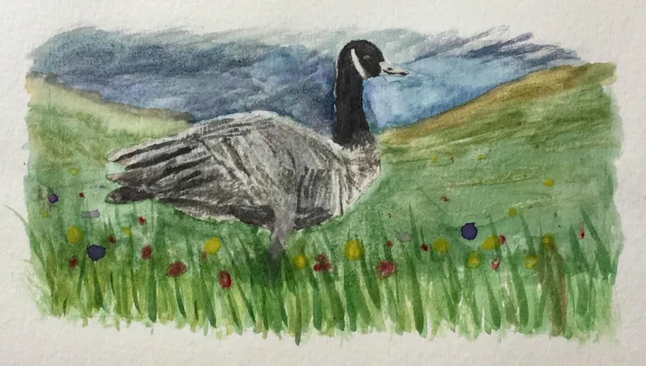

::: {.pm-page .pm-about role="main"}

# About us

::: {.pm-people}

::: {.pm-person}
## Peter

Peter writes physics and machine-learning software at NVIDIA. Before that he spent five years at MIT working out how to design aircraft with computers, and along the way he wrote [AeroSandbox](https://github.com/peterdsharpe/AeroSandbox), an open-source tool for doing it.

He likes building things that move: radio-controlled airplanes, electric skateboards, and the electric bike he used to ride to the lab.
:::

::: {.pm-person}
## Marta

Marta studied math at MIT, with minors in computer science and literature. She now manages a team of software developers who work on healthcare data, and she teaches machine-learning classes at work, with more than 250 people in each.

In 2019 she led the team that won MakeMIT, a 24-hour hardware hackathon, with [a tofu press you can run over Wi-Fi](https://devpost.com/software/tofupresto).
:::

:::

```{=html}
<figure class="pm-goose">
  
  <figcaption>A Canada goose, in watercolor. Peter painted it in 2017.</figcaption>
</figure>
```

::: {.pm-colophon}
## About the site

The site is made with [Quarto](https://quarto.org), which turns Markdown, math, and Python into web pages, and GitHub Pages hosts it. The text is set in [Alegreya](https://www.huertatipografica.com/en/fonts/alegreya-ht), designed by Juan Pablo del Peral. The green comes from the meadow in the goose painting. The [source](https://github.com/peterdsharpe/family-website) is on GitHub, if you'd like to see how it works.
:::

:::
